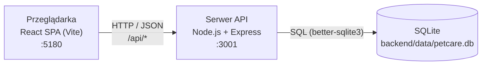

# 4. Architektura

## 4.1 Widok ogólny

Klasyczna architektura trójwarstwowa:

- W trybie deweloperskim Vite przekazuje żądania `/api/*` do backendu (proxy), więc frontend
  i API działają jak jedna aplikacja.
- Autoryzacja: po zalogowaniu backend wydaje token **JWT**; frontend dołącza go do każdego
  żądania w nagłówku `Authorization: Bearer <token>`.

## 4.2 Backend (`backend/src`)

| Plik / katalog               | Odpowiedzialność                                                    |
| ---------------------------- | ------------------------------------------------------------------- |
| `server.js`                  | Start: tworzy schemat bazy i uruchamia serwer HTTP                  |
| `app.js`                     | Konfiguracja Express: CORS, JSON, montowanie tras, błędy            |
| `config.js`                  | Odczyt i walidacja zmiennych środowiskowych (`.env`)                |
| `db/index.js`                | Połączenie z SQLite, włączenie kluczy obcych                        |
| `db/schema.sql`              | Definicja tabel (idempotentna – `CREATE TABLE IF NOT EXISTS`)       |
| `db/init.js`, `seed.js`      | Skrypty: tworzenie/reset bazy, dane testowe                         |
| `routes/`                    | Trasy API – jeden plik na moduł                                     |
| `middleware/auth.js`         | `requireAuth` (weryfikacja JWT), `signToken`                        |
| `middleware/errorHandler.js` | Obsługa błędów (404, 500)                                           |
| `utils/validation.js`        | Walidacja pól (e-mail, hasło, zwierzę, wizyta), `assertValid` → 400 |
| `utils/httpError.js`         | Klasa błędu z kodem HTTP                                            |

Przepływ żądania: `route → (requireAuth) → walidacja → zapytanie SQL → JSON`. Błąd rzucony jako
`HttpError` trafia do `errorHandler`, który zwraca `{ error, details }`.

## 4.3 Frontend (`frontend/src`)

Wygląd na podstawie projektu graficznego **„PetCare Veterinary Dashboard”** (Figma Make),
przeniesionego do zwykłego CSS (bez Tailwinda) i dopasowanego do modelu danych aplikacji.

| Katalog / plik | Odpowiedzialność                                                                   |
| -------------- | ---------------------------------------------------------------------------------- |
| `main.jsx`     | Punkt wejścia: `BrowserRouter` + `AuthProvider`                                    |
| `App.jsx`      | Definicja tras; trasy publiczne (`/login`, `/register`) i chronione                |
| `api/`         | `apiRequest()` – wspólny klient HTTP (token, błędy)                                |
| `context/`     | `AuthProvider` / `useAuth()` – token w `localStorage`, użytkownik, `request()`     |
| `hooks/`       | `useApiData` (pobieranie danych), `usePageMeta`, `useVisitActions`, `useDebounced` |
| `pages/`       | Strony powiązane z trasami                                                         |
| `components/`  | Layout (menu boczne, nagłówek), pola formularzy, karty wizyt, filtry, stany        |
| `utils/`       | Formatowanie dat/wieku/wagi po polsku, kolory kafelków, parametry filtrów          |
| `styles/`      | `index.css` – zmienne kolorów w `:root`, układ responsywny (800 px / 580 px)       |

### Trasy

| Ścieżka                           | Strona                                      | Wymagania         |
| --------------------------------- | ------------------------------------------- | ----------------- |
| `/login`, `/register`             | Logowanie, rejestracja                      | F-M-01, F-M-02    |
| `/`                               | Panel główny: statystyki, zwierzęta, wizyty | F-C-01, F-C-02    |
| `/pets`                           | Lista zwierząt z wyszukiwarką               | F-M-04, F-S-01    |
| `/pets/new`, `/pets/:id/edit`     | Formularz zwierzęcia                        | F-M-03, F-M-05    |
| `/pets/:id`                       | Szczegóły, notatki i wizyty zwierzęcia      | F-S-04, F-C-03    |
| `/visits`                         | Zaplanowane wizyty, filtry, „Zakończ”       | F-M-07, F-S-02/03 |
| `/history`                        | Historia (wizyty `done`), filtry            | F-M-07, F-S-02    |
| `/visits/new`, `/visits/:id/edit` | Formularz wizyty                            | F-M-06, F-M-08    |
| `/account`                        | Dane konta, wylogowanie                     | F-M-02 (PU-05)    |

### Zasady

- Niezalogowany użytkownik na trasie chronionej → przekierowanie do `/login` (po zalogowaniu
  powrót na żądaną stronę). Odpowiedź `401` z API (wygasły token) wylogowuje automatycznie.
- Formularze walidują dane przed wysłaniem; błędy pól z backendu (`details`) są wyświetlane
  pod odpowiednimi polami.
- Usunięcie zwierzęcia lub wizyty wymaga potwierdzenia (`window.confirm`).
- Aplikacja nie przechowuje zdjęć zwierząt – zamiast zdjęć z projektu graficznego używamy
  kolorowego kafelka z inicjałem imienia (kolor zależny od `id`).
- Elementy projektu bez odpowiednika w wymaganiach (lekarz prowadzący, mapa gabinetu,
  powiadomienia, zdjęcia, eksport) zostały pominięte.

## 4.4 Bezpieczeństwo

- Hasła: skrót **bcrypt** (koszt z `BCRYPT_ROUNDS`), nigdy nie są zwracane przez API.
- Sekret JWT tylko w `backend/.env` (plik poza repozytorium).
- Zapytania SQL wyłącznie parametryzowane – ochrona przed SQL injection.
- Każdy zasób sprawdzany pod kątem właściciela; cudzy zasób → 404.
