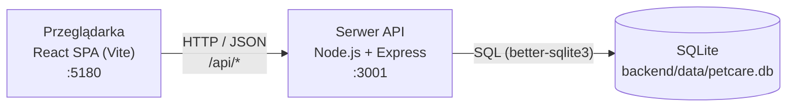

# 4. Architektura

## 4.1 Widok ogólny

Klasyczna architektura trójwarstwowa:

- W trybie deweloperskim Vite przekazuje żądania `/api/*` do backendu (proxy), więc frontend
  i API działają jak jedna aplikacja.
- Autoryzacja: po zalogowaniu backend wydaje token **JWT**; frontend dołącza go do każdego
  żądania w nagłówku `Authorization: Bearer <token>`.

## 4.2 Backend (`backend/src`)

| Plik / katalog                  | Odpowiedzialność                                                    |
| ------------------------------- | ------------------------------------------------------------------- |
| `server.js`                     | Start: schemat bazy, serwer HTTP, łagodne zamknięcie (Ctrl+C)       |
| `app.js`                        | Konfiguracja Express: CORS, JSON (maks. 100 kB), trasy, błędy       |
| `config.js`                     | Odczyt i walidacja zmiennych środowiskowych (`.env`)                |
| `db/index.js`                   | Połączenie z SQLite, włączenie kluczy obcych                        |
| `db/schema.sql`                 | Definicja tabel (idempotentna – `CREATE TABLE IF NOT EXISTS`)       |
| `db/init.js`, `seed.js`         | Skrypty: tworzenie/reset bazy, dane testowe                         |
| `routes/`                       | Trasy API – jeden plik na moduł                                     |
| `middleware/auth.js`            | `requireAuth` (weryfikacja JWT, tylko HS256), `signToken`           |
| `middleware/errorHandler.js`    | Obsługa błędów (400 zły JSON, 404, 413, 500)                        |
| `middleware/rateLimit.js`       | Limit nieudanych prób logowania/hasła z jednego IP → 429            |
| `middleware/securityHeaders.js` | Nagłówki bezpieczeństwa (nosniff, X-Frame-Options, CSP)             |
| `utils/validation.js`           | Walidacja pól (e-mail, hasło, zwierzę, wizyta), `assertValid` → 400 |
| `utils/httpError.js`            | Klasa błędu z kodem HTTP                                            |
| `utils/time.js`                 | Bieżący czas lokalny serwera, „najpóźniejsze dzisiaj” (UTC+14)      |

Język komunikatów API ustala middleware w `app.js` (`req.lang` z `Accept-Language`, domyślnie
`pl`); `errorHandler` tłumaczy `error` i `details` przez `utils/i18n.js` (słownik PL → EN).

Przepływ żądania: `route → (requireAuth) → walidacja → zapytanie SQL → JSON`. Błąd rzucony jako
`HttpError` trafia do `errorHandler`, który zwraca `{ error, details }`.

**Testy automatyczne** (`backend/test/`, `npm test`): wbudowany `node:test` – bez dodatkowych
zależności. Testy uruchamiają prawdziwą aplikację Express na losowym porcie z bazą SQLite
w pamięci (`DATABASE_PATH=:memory:`), więc nie dotykają pliku `data/petcare.db`.

## 4.3 Frontend (`frontend/src`)

Wygląd na podstawie projektu graficznego **„PetCare Veterinary Dashboard”** (Figma Make),
przeniesionego do zwykłego CSS (bez Tailwinda) i dopasowanego do modelu danych aplikacji.

| Katalog / plik | Odpowiedzialność                                                                                                     |
| -------------- | -------------------------------------------------------------------------------------------------------------------- |
| `main.jsx`     | Punkt wejścia: `BrowserRouter` + `AuthProvider`                                                                      |
| `App.jsx`      | Definicja tras; trasy publiczne (`/login`, `/register`) i chronione                                                  |
| `api/`         | `apiRequest()` – wspólny klient HTTP (token, błędy)                                                                  |
| `i18n/`        | Słowniki PL/EN (`messages.js`), bieżący język i `translate()` (`i18n.js`)                                            |
| `context/`     | `AuthProvider` / `useAuth()` – token w `localStorage`, użytkownik, `request()`                                       |
| `hooks/`       | `useApiData` (pobieranie danych), `usePageMeta`, `useVisitActions`, `useDebounced`, `useTheme`                       |
| `pages/`       | Strony powiązane z trasami                                                                                           |
| `components/`  | Layout (menu boczne, nagłówek), pola formularzy, karty wizyt, filtry, stany                                          |
| `utils/`       | Formatowanie dat/wieku/wagi po polsku, kolory kafelków, parametry filtrów                                            |
| `styles/`      | `index.css` – zmienne kolorów (jasne w `:root`, ciemne w `[data-theme='dark']`), układ responsywny (800 px / 580 px) |

### Trasy

| Ścieżka                           | Strona                                      | Wymagania         |
| --------------------------------- | ------------------------------------------- | ----------------- |
| `/login`, `/register`             | Logowanie, rejestracja                      | F-M-01, F-M-02    |
| `/`                               | Panel główny: statystyki, zwierzęta, wizyty | F-C-01, F-C-02    |
| `/pets`                           | Lista zwierząt z wyszukiwarką               | F-M-04, F-S-01    |
| `/pets/new`, `/pets/:id/edit`     | Formularz zwierzęcia                        | F-M-03, F-M-05    |
| `/pets/:id`                       | Szczegóły, notatki i wizyty zwierzęcia      | F-S-04, F-C-03    |
| `/visits`                         | Zaplanowane wizyty, filtry, „Zakończ”       | F-M-07, F-S-02/03 |
| `/history`                        | Historia (wizyty `done`), filtry            | F-M-07, F-S-02    |
| `/visits/new`, `/visits/:id/edit` | Formularz wizyty                            | F-M-06, F-M-08    |
| `/account`                        | Dane konta, wylogowanie                     | F-M-02 (PU-05)    |

### Zasady

- Niezalogowany użytkownik na trasie chronionej → przekierowanie do `/login` (po zalogowaniu
  powrót na żądaną stronę, razem z parametrami adresu, np. `?petId=`). Odpowiedź `401` z API
  (wygasły token) wylogowuje automatycznie i pokazuje na ekranie logowania komunikat
  „Sesja wygasła”. Wylogowanie lub zalogowanie w innej karcie jest synchronizowane przez
  zdarzenie `storage`.
- Pola formularzy (`Field`) wiążą komunikat błędu z polem (`aria-invalid`, `aria-describedby`);
  przyciski z samą ikoną mają `aria-label`.
- Wizyta zaplanowana z datą w przeszłości jest oznaczana jako **zaległa** („Po terminie”) i nie
  jest „najbliższą wizytą”. Oznaczenie jako zakończonej wizyty z przyszłości wymaga potwierdzenia,
  a formularz ostrzega o statusie „Zakończona” z przyszłą datą.
- Formularze walidują dane przed wysłaniem; błędy pól z backendu (`details`) są wyświetlane
  pod odpowiednimi polami.
- Usunięcie zwierzęcia lub wizyty wymaga potwierdzenia (`window.confirm`).
- Aplikacja nie przechowuje zdjęć zwierząt – zamiast zdjęć z projektu graficznego używamy
  kolorowego kafelka z inicjałem imienia (kolor zależny od `id`).
- **Języki PL/EN (NF-C-02)**: wszystkie teksty interfejsu są w `i18n/messages.js` (klucze
  wspólne dla obu języków, odmiana przez liczby jako funkcje). `LanguageProvider` / `useI18n()`
  dają funkcję `t(klucz, parametry)`; wybór (`LanguageSwitch` w nagłówku i na ekranach logowania)
  zapisywany jest w `localStorage` (`petcare-lang`), domyślnie polski. Daty formatowane są wg
  języka (`pl-PL` / `en-GB`), a klient API wysyła `Accept-Language`, więc błędy z backendu też są
  w wybranym języku. Dane wpisane przez użytkownika (gatunek, notatki, cel wizyty) nie są tłumaczone.
- **Tryb ciemny (NF-C-01)**: wszystkie kolory w `index.css` pochodzą ze zmiennych CSS;
  `:root[data-theme='dark']` nadpisuje je ciemnymi wartościami. Skrypt w `index.html` ustawia
  `data-theme` przed renderowaniem (bez błysku jasnego ekranu): zapisany wybór z `localStorage`
  (`petcare-theme`) albo ustawienie systemu (`prefers-color-scheme`). Przełącznik (`ThemeToggle`)
  jest w nagłówku i na ekranach logowania/rejestracji; bez ręcznego wyboru motyw podąża za systemem.
- Elementy projektu bez odpowiednika w wymaganiach (lekarz prowadzący, mapa gabinetu,
  powiadomienia, zdjęcia, eksport) zostały pominięte.

## 4.4 Bezpieczeństwo

- Hasła: skrót **bcrypt** (koszt z `BCRYPT_ROUNDS`), nigdy nie są zwracane przez API.
- Sekret JWT tylko w `backend/.env` (plik poza repozytorium).
- Zapytania SQL wyłącznie parametryzowane – ochrona przed SQL injection.
- Każdy zasób sprawdzany pod kątem właściciela; cudzy zasób → 404.
- **Limit nieudanych prób** (`middleware/rateLimit.js`): logowanie, rejestracja, zmiana hasła
  i usunięcie konta – po 10 odpowiedziach 4xx z jednego IP w ciągu 15 minut API zwraca `429`
  z `Retry-After`. Udane żądania nie są liczone, więc zwykły użytkownik nie jest blokowany.
  Licznik jest w pamięci procesu (wystarczy przy jednej instancji; reset po restarcie serwera).
- **Nagłówki bezpieczeństwa** na każdej odpowiedzi (`middleware/securityHeaders.js`):
  `X-Content-Type-Options: nosniff`, `X-Frame-Options: DENY`,
  `Content-Security-Policy: default-src 'none'; frame-ancestors 'none'`, `Referrer-Policy: no-referrer`.
- Haszowanie bcrypt jest asynchroniczne – nie blokuje obsługi innych żądań.
- Zmiana hasła i usunięcie konta wymagają podania obecnego hasła; złe hasło to `400` (błąd pola),
  a nie `401`, żeby frontend nie wylogował użytkownika.
- **Token w `localStorage` – świadomy kompromis.** Zaleta: prosty klient i brak problemów z CSRF
  (token nie jest wysyłany automatycznie jak ciasteczko). Wada: skrypt wstrzyknięty na stronę (XSS)
  mógłby odczytać token. Ryzyko ograniczają: React domyślnie escapuje dane w widokach, aplikacja
  nie używa `dangerouslySetInnerHTML` ani skryptów z zewnętrznych domen, token ma ograniczoną
  ważność (`JWT_EXPIRES_IN`, domyślnie 1 dzień). Bezpieczniejszą alternatywą byłoby ciasteczko
  `HttpOnly` + `SameSite` (wymaga ochrony CSRF) – uznaliśmy je za zbyt rozbudowane na ten projekt.
- **Czas i strefy czasowe.** Daty wizyt są zapisane jako czas lokalny bez strefy
  (`YYYY-MM-DDTHH:MM`), dlatego „teraz” (najbliższa / zaległa wizyta) to lokalny czas serwera –
  zakładamy, że serwer i użytkownicy są w tej samej strefie. Data urodzenia „z przyszłości” jest
  sprawdzana wg najpóźniejszej strefy (UTC+14), żeby „dzisiaj” użytkownika zawsze było poprawne.
