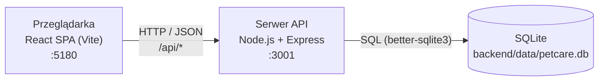

# 4. Architektura

## 4.1 Widok ogólny

Klasyczna architektura trójwarstwowa:

- W trybie deweloperskim Vite przekazuje żądania `/api/*` do backendu (proxy), więc frontend
  i API działają jak jedna aplikacja.
- Autoryzacja: po zalogowaniu backend wydaje token **JWT**; frontend dołącza go do każdego
  żądania w nagłówku `Authorization: Bearer <token>`.

## 4.2 Backend (`backend/src`)

| Plik / katalog          | Odpowiedzialność                                              |
| ----------------------- | ------------------------------------------------------------- |
| `server.js`             | Start: tworzy schemat bazy i uruchamia serwer HTTP            |
| `app.js`                | Konfiguracja Express: CORS, JSON, montowanie tras, błędy      |
| `config.js`             | Odczyt i walidacja zmiennych środowiskowych (`.env`)          |
| `db/index.js`           | Połączenie z SQLite, włączenie kluczy obcych                  |
| `db/schema.sql`         | Definicja tabel (idempotentna – `CREATE TABLE IF NOT EXISTS`) |
| `db/init.js`, `seed.js` | Skrypty: tworzenie/reset bazy, dane testowe                   |
| `routes/`               | Trasy API – jeden plik na moduł                               |
| `middleware/`           | Obsługa błędów (404, 500), później: `requireAuth`             |
| `utils/httpError.js`    | Klasa błędu z kodem HTTP                                      |

Przepływ żądania: `route → (requireAuth) → walidacja → zapytanie SQL → JSON`. Błąd rzucony jako
`HttpError` trafia do `errorHandler`, który zwraca `{ error, details }`.

## 4.3 Frontend (`frontend/src`)

| Katalog       | Odpowiedzialność                                        |
| ------------- | ------------------------------------------------------- |
| `main.jsx`    | Punkt wejścia, `BrowserRouter`                          |
| `App.jsx`     | Definicja tras (stron)                                  |
| `api/`        | `apiRequest()` – wspólny klient HTTP (token, błędy)     |
| `context/`    | Stan globalny (zalogowany użytkownik) – do zrobienia    |
| `pages/`      | Strony powiązane z trasami                              |
| `components/` | Komponenty wielokrotnego użytku (formularze, nawigacja) |
| `styles/`     | CSS (zmienne kolorów w `:root`)                         |

## 4.4 Bezpieczeństwo

- Hasła: skrót **bcrypt** (koszt z `BCRYPT_ROUNDS`), nigdy nie są zwracane przez API.
- Sekret JWT tylko w `backend/.env` (plik poza repozytorium).
- Zapytania SQL wyłącznie parametryzowane – ochrona przed SQL injection.
- Każdy zasób sprawdzany pod kątem właściciela; cudzy zasób → 404.
