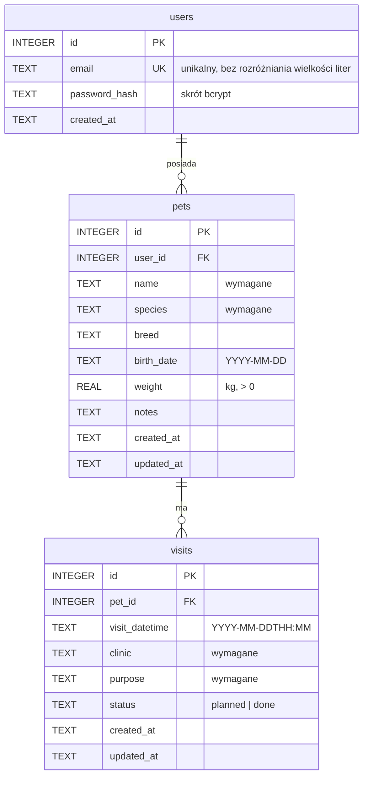

# 5. Baza danych

SQLite, plik `backend/data/petcare.db`. Definicja: [`backend/src/db/schema.sql`](../backend/src/db/schema.sql).
Klucze obce włączone (`PRAGMA foreign_keys = ON`).

## 5.1 Diagram ERD

## 5.2 Relacje

- **users 1 — * pets**: jeden użytkownik może mieć wiele zwierząt.
- **pets 1 — * visits**: jedno zwierzę może mieć wiele wizyt.
- Obie relacje mają `ON DELETE CASCADE` – usunięcie zwierzęcia usuwa jego wizyty.

## 5.3 Ograniczenia i indeksy

| Tabela   | Ograniczenie                                         |
| -------- | ---------------------------------------------------- |
| `users`  | `email` UNIQUE, `COLLATE NOCASE`                     |
| `pets`   | `weight IS NULL OR weight > 0`                       |
| `visits` | `status IN ('planned', 'done')`, domyślnie `planned` |

Indeksy: `pets(user_id)`, `visits(pet_id)`, `visits(visit_datetime)`.

## 5.4 Skrypty

| Polecenie          | Działanie                                              |
| ------------------ | ------------------------------------------------------ |
| `npm run db:init`  | Tworzy brakujące tabele (robi to też start serwera)    |
| `npm run db:seed`  | Dodaje konto demo z 2 zwierzętami i 3 wizytami         |
| `npm run db:reset` | Usuwa wszystkie dane, tworzy tabele i dodaje dane demo |
